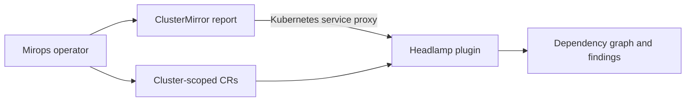

# Mirops Headlamp plugin

Explore a Mirops Cluster Mirror where Kubernetes work happens: in Headlamp. The plugin makes dependency paths, namespace risk, compatibility findings, and upgrade-analysis detail readable without hiding the underlying decision.



## What you can investigate

- Current Cluster Mirror summary and namespace risk.
- At-risk components and the dependents that make up their blast radius.
- Dependency graph, workload tables, score breakdown, and deprecated API findings.
- `UpgradeAnalysis` detail: decision, conditions, blockers, metrics, compatibility, and optional AI reasoning.
- `RemediationPlan` review and explicit, approval-based execution.

The score is a health gauge. The actionable pipeline gate is `decision.allow`; a high score never overrides a deterministic blocker.

## Data sources

| Source | Used for |
| --- | --- |
| ClusterMirror report | Graph, risk, workloads, findings, and report detail. |
| Kubernetes API | Cluster-scoped `ClusterMirror`, `UpgradeAnalysis`, and `RemediationPlan` state. |
| Service proxy | Reads reports without assuming direct browser access to the operator service. |

## Install with Headlamp

See [deploy/headlamp-values.yaml](deploy/headlamp-values.yaml) for the complete configuration.

```sh
helm repo add headlamp https://kubernetes-sigs.github.io/headlamp/
helm repo update
helm install headlamp headlamp/headlamp \
  --namespace headlamp \
  --create-namespace \
  -f deploy/headlamp-values.yaml
kubectl -n headlamp port-forward svc/headlamp 8080:80
```

Configure `MIROPS_NAMESPACE` in the plugin’s init-container environment when the operator is not installed in `mirops`.

## Develop

Requires Node.js 18 through 22.

```sh
npm install
npm start
npm run tsc
npm run lint
npm run build
```

## Open source

Mirops is better when risk remains inspectable. Contributions that improve accessibility, graph clarity, or Kubernetes integration are welcome. The plugin is licensed under [Apache License 2.0](LICENSE).

