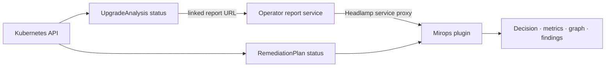

# Mirops for Headlamp

Review Kubernetes upgrade analyses where cluster operators already work. The Headlamp plugin presents the operator’s decision, readiness details, compatibility findings, and dependency-risk graph, while keeping the underlying `UpgradeAnalysis` and `RemediationPlan` resources visible through Kubernetes.



## What the plugin shows

- A list of `UpgradeAnalysis` resources and a guided form for creating one.
- Analysis decision and conditions, blockers, health and capacity metrics, score breakdown, add-on compatibility, and deprecated-API findings.
- A dependency graph and risk details from the analysis report when those fields are present.
- Optional AI reasoning and associated remediation-plan detail.
- `RemediationPlan` review, including proposed actions and approval status.

The readiness score is a health gauge; the deterministic decision and its blockers are the upgrade gate. A high score does not override a blocking finding. This development-branch plugin does not provide ClusterMirror list/detail pages.

## Data flow and access

The plugin reads cluster-scoped `UpgradeAnalysis` and `RemediationPlan` custom resources through Headlamp’s Kubernetes access. For report content, it requests the operator’s reports service through Headlamp’s in-cluster service proxy. The configured report namespace is written to the plugin’s `config.json` by the install init container.

| Data | Source |
| --- | --- |
| Analysis target, status, decision, conditions | `UpgradeAnalysis` resource. |
| Proposed action and approval status | `RemediationPlan` resource. |
| Graph, detailed metrics, findings, score components, AI reasoning | Report served by the Mirops reports service. |

Grant Headlamp users only the Kubernetes permissions needed to view or create these resources; access to a resource is governed by cluster RBAC. The plugin itself does not bypass authorization.

## Install in Headlamp

The provided [`deploy/headlamp-values.yaml`](deploy/headlamp-values.yaml) loads the plugin from a private development image. Create the GHCR pull secret in the `headlamp` namespace first, using a GitHub token with package-read permission:

```sh
kubectl create secret docker-registry ghcr-mirops \
  --namespace headlamp \
  --docker-server=ghcr.io \
  --docker-username=<github-user> \
  --docker-password=<token-with-read-packages>

helm repo add headlamp https://kubernetes-sigs.github.io/headlamp/
helm repo update
helm upgrade --install headlamp headlamp/headlamp \
  --namespace headlamp \
  --create-namespace \
  -f deploy/headlamp-values.yaml
kubectl -n headlamp port-forward svc/headlamp 8080:80
```

Open `http://localhost:8080`. The values file uses `MIROPS_NAMESPACE=mirops`; change it if the operator and reports service are installed in another namespace. The init container copies the plugin into Headlamp’s plugin directory and generates the namespace configuration. After a new `:dev` image is published, restart the Headlamp deployment to refresh it:

```sh
kubectl -n headlamp rollout restart deployment/headlamp
```

## Develop locally

Requires Node.js 18–22.

```sh
npm install
npm start       # Headlamp plugin development server
npm run tsc     # TypeScript check
npm run lint
npm run build
```

The project’s format command is `npm run format` (it formats `src/`). Components, resource definitions, and plugin registration live in `src/`.

## Contribute

Helpful contributions include clearer risk explanations, accessible graph interactions, and tests around report/resource edge cases. Keep the UI explicit about the distinction between health score and decision. See the repository’s [Apache-2.0 license](LICENSE) and open a focused pull request.
